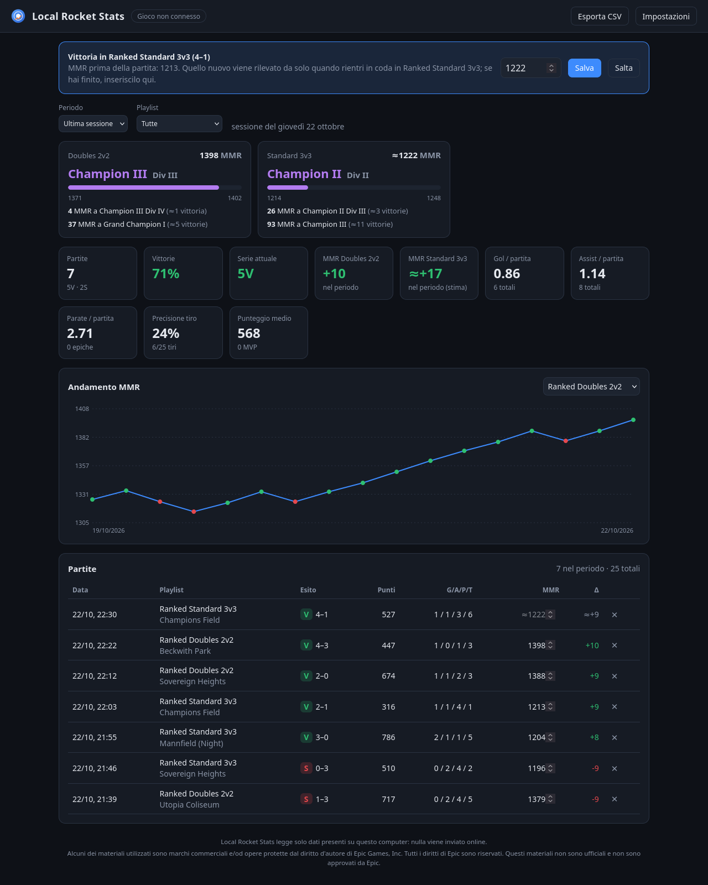
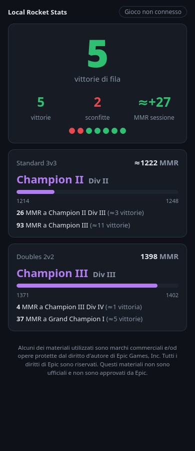

# Local Rocket Stats

[English](README.md) · **Italiano**

Statistiche e **MMR** di **Rocket League** partita per partita, leggendo solo i dati che il
gioco lascia sul tuo computer: il socket ufficiale della **Stats API** e il **log** del gioco.
Niente login, niente API online, niente mod: aggiornamenti istantanei e nulla esce dal tuo PC.
Per Linux (anche con Proton) e Windows, scritto in Rust.



| Pagina per il telefono | |
|---|---|
|  | Serie di vittorie, record della sessione, avanzamento del rango e punteggio live sul telefono, dalla stessa rete Wi-Fi. |

> Progetto amatoriale non ufficiale, non affiliato né approvato da Psyonix o Epic Games.
> Alcuni dei materiali utilizzati sono marchi commerciali e/od opere protette dal diritto
> d'autore di Epic Games, Inc. Tutti i diritti di Epic sono riservati. Questi materiali non
> sono ufficiali e non sono approvati da Epic.

## Funzioni

- **Ogni partita, in automatico**: risultato, punteggio, supplementari, i tuoi punti, gol,
  assist, parate, tiri, demolizioni e tocchi, le statistiche di tutti i giocatori, i gol (con
  velocità) e gli eventi (parate epiche, MVP…). Le partite abbandonate sono segnate come tali.
- **MMR senza scriverlo**: il gioco scrive il tuo MMR nel log ogni volta che entri in coda;
  quel valore è l'MMR finale della partita precedente in quella playlist, quindi il tracker lo
  compila da solo. Finché il valore esatto non è noto (ultima partita della serata) vedi una
  stima (≈). Puoi sempre scriverlo a mano: i valori inseriti non vengono mai sovrascritti.
- **Rango e divisione**: rango attuale, divisione, barra di avanzamento e quanto MMR (e circa
  quante vittorie) mancano alla divisione e al rango successivi, per 1v1, 2v2 e 3v3.
- **Partite giocate a tracker spento** recuperate dai log recenti del gioco (punteggio, arena,
  supplementari, punti, MMR e risultato; senza statistiche per giocatore).
- **Dashboard**: sessioni, serie, percentuale di vittorie, medie per partita, precisione al
  tiro, grafico dell'MMR, tabella delle partite con dettagli, esportazione CSV.
- **Pagina per il telefono** in rete locale (sola lettura) e **overlay per OBS**
  (`http://127.0.0.1:8765/overlay`).
- **Icona nella tray**: stato (gioco connesso, in partita con il punteggio), apri dashboard,
  accesso dal telefono, abilita la Stats API del gioco, avvio all'accesso, lingua, esci.
- **Inglese e italiano**, secondo la lingua di sistema o scelta nelle impostazioni.

## Come funziona

| Fonte | Cosa dà | Note |
|---|---|---|
| [Stats API](https://www.rocketleague.com/developer/stats-api) (TCP `127.0.0.1:49123`) | eventi e statistiche della partita in tempo reale | ufficiale, documentata da Psyonix; si attiva in `TAStatsAPI.ini` |
| `TAGame/Logs/Launch.log` | MMR e tier quando entri in coda, riassunto delle classificate | il log contiene lo skill interno `mu`; MMR = `mu × 20 + 100` (vedi Crediti) |

Il tracker non tocca mai il processo del gioco, la sua memoria o il suo traffico di rete,
quindi funziona con Easy Anti-Cheat attivo.

## Installazione

### Arch Linux (AUR)

```bash
yay -S local-rocket-stats-bin   # binario precompilato
yay -S local-rocket-stats       # compilato dai sorgenti
```

### Windows

Scarica `local-rocket-stats-<versione>-windows-x86_64.zip` dalle
[release](https://github.com/deddroid/local-rocket-stats/releases), estrailo e avvia
`local-rocket-stats.exe`. Al primo avvio Windows SmartScreen può avvisare che l'app non è
firmata.

### Altre distribuzioni Linux

Scarica la release `linux-x86_64.tar.gz`, estraila e lancia `./install.sh` (installa in
`~/.local`, senza root). Dai sorgenti: `./install.sh` compila prima con `cargo`;
`./install.sh --uninstall` rimuove tutto (i tuoi dati restano).

## Primo avvio

1. **Abilita la Stats API** una volta: dal menu della tray (*Abilita la Stats API del gioco*)
   oppure con `local-rocket-stats setup`. Imposta `PacketSendRate=10` nel `TAStatsAPI.ini` che
   il gioco legge davvero: `Documenti/My Games/Rocket League/TAGame/Config` su Windows, la stessa
   cartella dentro il prefisso Proton su Linux (Steam `compatdata/252950`, prefissi di Heroic).
2. **Riavvia Rocket League.** Quando funziona la tray mostra *Gioco connesso*.
3. Gioca. Il tuo giocatore viene riconosciuto da solo (è l'auto seguita dalla telecamera); se
   hai più account aggiungi i loro ID in *Impostazioni*.

Per vedere l'MMR nel gioco a fine partita classificata, attivalo nelle impostazioni del gioco
(dalla Season 22).

## Riga di comando

```text
local-rocket-stats                 avvia con la tray e apre la dashboard
  --no-tray --no-browser           senza interfaccia (fermalo con Ctrl+C)
  --lan                            rende la dashboard visibile in rete locale (sola lettura)
  --port 8765 --game-port 49123 --db <file> --no-log
local-rocket-stats setup [--path <ini>] [--rate 10]
local-rocket-stats simulate [--game-port 49123] [--matches 3] [--speed 20]
```

`simulate` finge di essere il gioco: avvialo, poi avvia l'app con lo stesso `--game-port`.

### Accesso dal telefono

Attiva *Accesso dal telefono* nella tray (o avvia con `--lan`); la tray mostra l'indirizzo,
ad esempio `http://192.168.1.10:8765/phone`. Gli altri dispositivi possono solo leggere. Su
Linux con un firewall (es. `ufw`) apri la porta per la tua rete:

```bash
sudo ufw allow from 192.168.0.0/16 to any port 8765 proto tcp
```

## File

| | Linux | Windows |
|---|---|---|
| Partite (SQLite) | `~/.local/share/local-rocket-stats/matches.db` | `%APPDATA%\local-rocket-stats\matches.db` |
| Impostazioni | `~/.config/local-rocket-stats/settings.toml` | `%APPDATA%\local-rocket-stats\settings.toml` |
| Log | `~/.local/state/local-rocket-stats/tracker.log` | `%APPDATA%\local-rocket-stats\tracker.log` |

## Limiti noti

- L'MMR esatto dopo l'**ultima partita di una sessione** si conosce solo alla coda successiva
  in quella playlist (il gioco lo scrive nel log solo allora); fino ad allora è stimato.
- **In party** il log riporta l'MMR del capo party, quindi viene ignorato.
- Le **soglie delle divisioni** sono stime della community (dati Tracker Network via
  eloascend.com, ottobre 2026; le divisioni di 1v1 e 3v3 sono interpolate) e si spostano
  durante la stagione. Il tier letto dal log ha sempre la precedenza. Si aggiornano in
  `web/ranks.js`.
- La versione **Windows** è compilata e testata dalla CI ma non è ancora stata provata a mano.

## Aspetti legali

- **Non affiliato** a Psyonix o Epic Games; gratuito e non commerciale, secondo la
  [Fan Content Policy di Epic Games](https://legal.epicgames.com/epicgames/fan-art-policy). Il
  disclaimer richiesto compare in ogni pagina della dashboard. Non usa loghi o grafica di Epic;
  l'icona è originale.
- Usa solo la **Stats API ufficiale**, che Psyonix documenta per i programmi di terze parti, e
  i file che il gioco scrive nella tua cartella utente. Non modifica il gioco, non vi si
  inietta e non ne legge la memoria, e non dà vantaggi competitivi, come previsto dalle regole
  di Rocket League sul software di terze parti.
- **Privacy**: tutto resta in un database locale. Nomi e statistiche degli altri giocatori
  delle tue partite sono salvati solo sul tuo computer, per uso personale.
- Le dipendenze sono open source con licenze compatibili con MIT: vedi
  [THIRD-PARTY-NOTICES](THIRD-PARTY-NOTICES).

## Crediti

- Autore: **deddroid**, sviluppato con **Claude** (Anthropic).
- Documentazione della [Stats API di Rocket League](https://www.rocketleague.com/developer/stats-api)
  di Psyonix.
- Soglie dei ranghi: dati Tracker Network pubblicati da
  [eloascend.com](https://www.eloascend.com/blog/rocket-league/ranks-and-mmr).
- La conversione dell'MMR (`mu × 20 + 100`) non è documentata da Psyonix: è ricavata da log
  reali, dove concorda con il tier scritto dal gioco accanto al valore e con le soglie delle
  divisioni della community.

## Licenza

[MIT](LICENSE)
