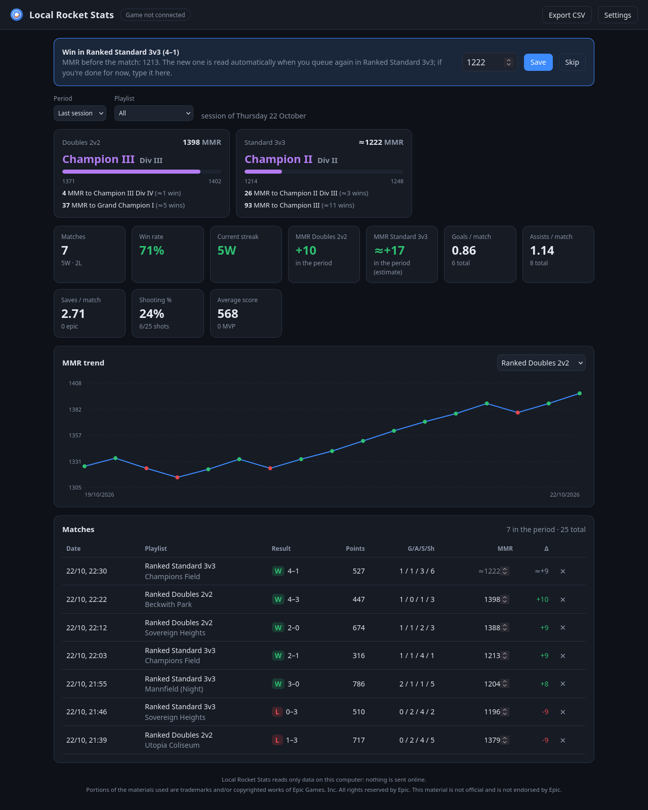
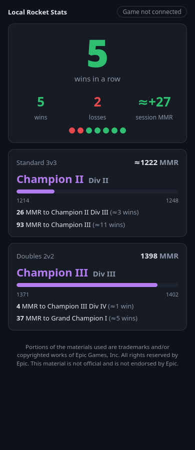

# Local Rocket Stats

**English** · [Italiano](README.it.md)

Match-by-match **Rocket League** stats and **MMR** tracker that reads only the data the game
leaves on your own computer: the official **Stats API** socket and the game **log**. No
login, no online API, no mods: updates are instant and nothing leaves your PC.
For Linux (including Proton) and Windows, written in Rust.



| Phone page | |
|---|---|
|  | Win streak, session record, rank progress and live score on your phone, from the same Wi-Fi. |

> Unofficial fan project, not affiliated with or endorsed by Psyonix or Epic Games. Portions
> of the materials used are trademarks and/or copyrighted works of Epic Games, Inc. All
> rights reserved by Epic. This material is not official and is not endorsed by Epic.

## Features

- **Every match, automatically**: result, score, overtime, your score, goals, assists, saves,
  shots, demos and touches, every player's stats, goal log (with speed) and statfeed events
  (epic saves, MVP…). Leaving early is recorded as such.
- **MMR without typing it**: the game writes your MMR in its log each time you join a queue;
  that value is your final MMR after the previous match in that playlist, so the tracker fills
  it in by itself. While the exact value isn't known yet (last match of the evening) you see
  an estimate (≈). You can always type it yourself: typed values are never overwritten.
- **Rank and division**: current rank, division, a progress bar and how much MMR (and roughly
  how many wins) you need for the next division and rank, for 1v1, 2v2 and 3v3.
- **Matches played while the tracker was off** are recovered from the game's recent logs
  (score, arena, overtime, points, MMR and result; no per-player stats).
- **Dashboard**: sessions, streaks, win rate, per-match averages, shooting %, MMR chart, match
  table with details, CSV export.
- **Phone page** on your local network (read-only) and an **OBS overlay**
  (`http://127.0.0.1:8765/overlay`).
- **Tray icon**: status (game connected, in a match with the score), open the dashboard,
  phone access, enable the game's Stats API, start at login, language, quit.
- **English and Italian**, following the system language or chosen in the settings.

## How it works

| Source | What it gives | Notes |
|---|---|---|
| [Stats API](https://www.rocketleague.com/developer/stats-api) (TCP `127.0.0.1:49123`) | live match events and stats | official, documented by Psyonix; enabled in `TAStatsAPI.ini` |
| `TAGame/Logs/Launch.log` | MMR and rank tier when you queue, summary of ranked matches | the log has the internal skill `mu`; MMR = `mu × 20 + 100` (see Credits) |

The tracker never touches the game process, its memory or its network traffic, so it works
with Easy Anti-Cheat on.

## Installation

### Arch Linux (AUR)

```bash
yay -S local-rocket-stats-bin   # prebuilt
yay -S local-rocket-stats       # built from source
```

### Windows

Download `local-rocket-stats-<version>-windows-x86_64.zip` from the
[releases](https://github.com/deddroid/local-rocket-stats/releases), extract it and run
`local-rocket-stats.exe`. Windows SmartScreen may warn about an unsigned app the first time.

### Other Linux distributions

Download the `linux-x86_64.tar.gz` release, extract it and run `./install.sh` (installs to
`~/.local`, no root). From the sources: `./install.sh` builds with `cargo` first;
`./install.sh --uninstall` removes it (your data is kept).

## First run

1. **Enable the Stats API** once: from the tray menu (*Enable the game's Stats API*) or with
   `local-rocket-stats setup`. It sets `PacketSendRate=10` in the `TAStatsAPI.ini` the game
   actually reads: `Documents/My Games/Rocket League/TAGame/Config` on Windows, the same
   folder inside the Proton prefix on Linux (Steam `compatdata/252950`, Heroic prefixes).
2. **Restart Rocket League.** The tray shows *Game connected* when it's working.
3. Play. Your player is recognised automatically (the car the camera follows); with several
   accounts, add their ids in *Settings*.

To see the MMR in game after a ranked match, turn it on in the game settings (Season 22+).

## Command line

```text
local-rocket-stats                 start with the tray and open the dashboard
  --no-tray --no-browser           headless (stop with Ctrl+C)
  --lan                            also serve the dashboard to the local network (read-only)
  --port 8765 --game-port 49123 --db <file> --no-log
local-rocket-stats setup [--path <ini>] [--rate 10]
local-rocket-stats simulate [--game-port 49123] [--matches 3] [--speed 20]
```

`simulate` pretends to be the game: run it, then start the app with the same `--game-port`.

### Phone access

Turn on *Phone access* in the tray (or start with `--lan`); the tray shows the address,
e.g. `http://192.168.1.10:8765/phone`. Other devices can only read. On Linux with a firewall
(e.g. `ufw`) allow the port for your network:

```bash
sudo ufw allow from 192.168.0.0/16 to any port 8765 proto tcp
```

## Files

| | Linux | Windows |
|---|---|---|
| Matches (SQLite) | `~/.local/share/local-rocket-stats/matches.db` | `%APPDATA%\local-rocket-stats\matches.db` |
| Settings | `~/.config/local-rocket-stats/settings.toml` | `%APPDATA%\local-rocket-stats\settings.toml` |
| Log | `~/.local/state/local-rocket-stats/tracker.log` | `%APPDATA%\local-rocket-stats\tracker.log` |

## Known limits

- The exact MMR after your **last match of a session** is known only at your next queue in
  that playlist (the game writes it to the log only then); until then it is estimated.
- **In a party** the log shows the party leader's MMR, so it is ignored.
- Rank **division thresholds** are community estimates (Tracker Network data via
  eloascend.com, October 2026; 1v1 and 3v3 divisions are interpolated) and drift during a
  season. The rank tier read from the log always wins. Update them in `web/ranks.js`.
- The **Windows** build is compiled and tested by CI but has not been tried by hand yet.

## Legal

- **Not affiliated** with Psyonix or Epic Games; free and non-commercial, following the
  [Epic Games Fan Content Policy](https://legal.epicgames.com/epicgames/fan-art-policy). The
  required disclaimer is shown on every page of the dashboard. No Epic logo or artwork is used;
  the icon is original.
- Uses only the **official Stats API**, which Psyonix documents for third-party programs, and
  files the game writes in your user folder. It does not modify, inject into or read the
  memory of the game, and gives no competitive advantage, in line with the Rocket League
  rules for third-party software.
- **Privacy**: everything stays in a local database. Other players' names and stats from your
  matches are stored only on your computer, for your personal use.
- Dependencies are open source with licenses compatible with MIT: see
  [THIRD-PARTY-NOTICES](THIRD-PARTY-NOTICES).

## Credits

- Author: **deddroid**, developed with **Claude** (Anthropic).
- [Rocket League Stats API](https://www.rocketleague.com/developer/stats-api) documentation by
  Psyonix.
- Rank thresholds: Tracker Network data as published by
  [eloascend.com](https://www.eloascend.com/blog/rocket-league/ranks-and-mmr).
- The MMR conversion (`mu × 20 + 100`) is not documented by Psyonix: it was worked out from
  real logs, where it agrees with the rank tier the game writes next to it and with the
  community division thresholds.

## License

[MIT](LICENSE)
